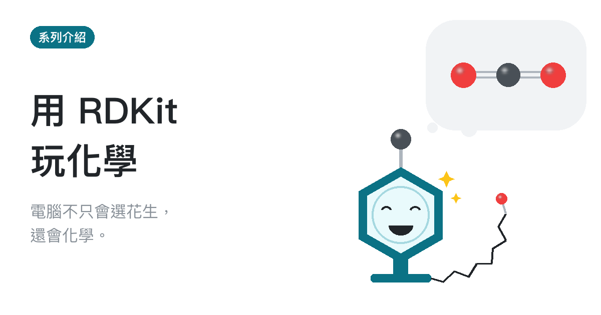

::: {.series-hero}
[{.series-hero-img fig-alt="《用 RDKit 玩化學》系列介紹圖：吉祥物小電腦想著二氧化碳分子"}](rdkit/index.qmd)

::: {.series-hero-text}
[系列]{.series-hero-tag}

## 用 RDKit 玩化學

一集三分鐘，一集一個 RDKit 功能。不用會寫程式，在網頁上改一改分子，馬上看到電腦怎麼讀、怎麼畫、怎麼比較分子。

[從第 1 集開始](posts/2026-11-rdkit-01-molfromsmiles/index.qmd){.btn .btn-primary}
[看全部 26 集](rdkit/index.qmd){.btn .btn-outline-primary}
:::
:::

## 所有文章 {.listing-heading}

::: {#all-posts}
:::
