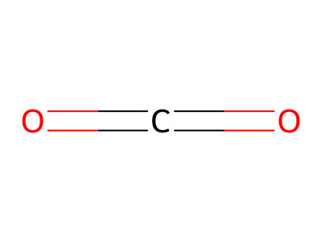

二氧化碳的化學式是 CO2，結構式畫成 O=C=O。不過電腦沒有眼睛，看不懂畫在紙上的結構式，要先把分子寫成一串字，電腦才讀得進去。這串字叫做 **SMILES**（Simplified Molecular Input Line Entry System）。

二氧化碳的 SMILES 是 `O=C=O`：中間一個碳，兩邊各一個氧，`=` 代表雙鍵。

## 動手玩

下面的輸入框已經填好二氧化碳的 `O=C=O`。試著改掉框裡的字串，例如換成 `CCO`，下方就會畫出新的化學結構。不知道要打什麼，也可以從選單挑一個分子。

```{=html}
<div class="rdkit-play" data-mode="parse">
<script type="application/json">
{"molecules": [
  {"name": "二氧化碳", "smiles": "O=C=O"},
  {"name": "水", "smiles": "O"},
  {"name": "甲烷（天然氣的主要成分）", "smiles": "C"},
  {"name": "酒精（乙醇）", "smiles": "CCO"},
  {"name": "咖啡因", "smiles": "CN1C=NC2=C1C(=O)N(C(=O)N2C)C"}
]}
</script>
<figure class="rdkit-play-fallback">

<figcaption>RDKit 讀入 <code>O=C=O</code> 後畫出的二氧化碳。</figcaption>
</figure>
</div>
```

## 剛才發生什麼事？

小框裡跑的是 **RDKit**，一套免費、開放原始碼的化學工具。RDKit 讀到 `O=C=O`，就知道這裡有 3 個原子：碳在中間，兩邊各用雙鍵接一個氧，接著把結構畫出來。

這個步驟是把 SMILES 轉成 **分子物件**（molecule object）。之後算分子量、找結構、比較兩個分子像不像，都要先有分子物件，所以整個系列就從這一步開始。

細心一點會發現，水的 SMILES 只有一個 `O`，甲烷只有一個 `C`。SMILES 平常不寫氫，由 RDKit 自動補上。

## 真正的程式

在 Python 裡，這件事只要一行 `Chem.MolFromSmiles`：

```python
from rdkit import Chem

mol = Chem.MolFromSmiles("O=C=O")
mol   # 在 Colab 或 Jupyter 裡，最後一行會直接畫出分子
```

[](https://colab.research.google.com/github/517justin/cheminfo-blog/blob/main/posts/2026-11-rdkit-01-molfromsmiles/ep01.ipynb)
[下載這一集的 notebook](ep01.ipynb)

## 換你試

- 在輸入框打 `CCO`，看看酒精（乙醇）長什麼樣子。
- 故意少打一個字，改成 `O=C=`，看看電腦怎麼回應。

## 延伸閱讀

- 《化學資訊學入門》[SMILES](https://517justin.github.io/cheminfo-intro/chapters/ch01/01-02-smiles.html)
- RDKit 官方文件：[Reading single molecules](https://www.rdkit.org/docs/GettingStartedInPython.html#reading-single-molecules)
