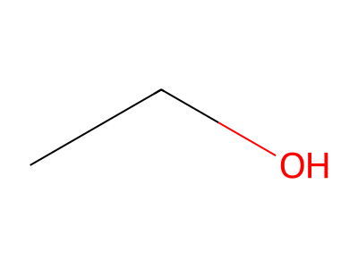

酒精（乙醇）的 SMILES 可以從碳開始寫成 `CCO`，也可以從氧開始寫成 `OCC`，還可以寫成 `C(O)C`，括號代表從中間那個碳分出去的支鏈。三種寫法都是同一個酒精。

人一看就知道是同一個東西，但電腦如果只比對字串，`CCO` 和 `OCC` 是兩串不同的字，會被當成兩種不同的分子。

## 動手玩

從選單挑一種寫法，或在輸入框裡自己改 SMILES。下方會列出你寫的字串和電腦整理後的寫法，並畫出結構。

```{=html}
<div class="rdkit-play" data-mode="canon">
<script type="application/json">
{"molecules": [
  {"name": "酒精（乙醇）：從碳開始寫", "smiles": "CCO"},
  {"name": "酒精（乙醇）：從氧開始寫", "smiles": "OCC"},
  {"name": "酒精（乙醇）：用括號寫", "smiles": "C(O)C"},
  {"name": "醋酸（乙酸）", "smiles": "CC(=O)O"},
  {"name": "醋酸（乙酸）：另一種寫法", "smiles": "OC(C)=O"}
]}
</script>
<figure class="rdkit-play-fallback">

<figcaption><code>CCO</code>、<code>OCC</code>、<code>C(O)C</code> 經 RDKit 整理後，都得到 <code>CCO</code>。</figcaption>
</figure>
</div>
```

## 剛才發生什麼事？

RDKit 先把 SMILES 讀成分子物件，再用 `MolToSmiles` 寫回 SMILES。寫回去時，RDKit 會照一套固定的規則，決定從哪個原子開始、往哪個方向寫，所以同一個分子不管原本怎麼寫，最後都會變成同一串字。

這種整理過的寫法叫做 **正規 SMILES**（canonical SMILES）。三種酒精的寫法都會變成 `CCO`，兩種醋酸的寫法都會變成 `CC(=O)O`。想確認兩份清單裡是不是同一個分子，先把兩邊都轉成正規 SMILES 再比對，就不會被寫法騙了。

不過，這套規則是每個軟體自己訂的，不同軟體整理出來的字串可能不一樣。比對時，兩邊要用同一套工具。

## 真正的程式

```python
from rdkit import Chem

for smi in ["CCO", "OCC", "C(O)C"]:
    mol = Chem.MolFromSmiles(smi)
    print(smi, "→", Chem.MolToSmiles(mol))
```

三行都會印出 `→ CCO`。

[](https://colab.research.google.com/github/517justin/cheminfo-blog/blob/main/posts/2026-11-rdkit-02-moltosmiles/ep02.ipynb)
[下載這一集的 notebook](ep02.ipynb)

## 換你試

- 自己想一種酒精的新寫法，例如 `C(C)O`，在輸入框打打看，是不是也變成 `CCO`。
- 把氫也寫出來，輸入 `[CH3][CH2][OH]`，結果還是 `CCO`。

## 延伸閱讀

- 《化學資訊學入門》[SMILES](https://517justin.github.io/cheminfo-intro/chapters/ch01/01-02-smiles.html)
- RDKit 官方文件：[Writing molecules](https://www.rdkit.org/docs/GettingStartedInPython.html#writing-molecules)
