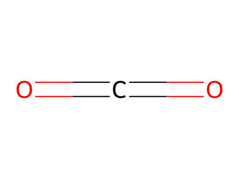

如果把二氧化碳的 SMILES 少打一個字，寫成 `O=C=`，電腦還讀得懂嗎？打錯字很常見：少打一個字、括號忘了關，或是不小心讓一個碳接了太多根鍵。電腦會不會把打錯的字串當成分子，接著算出一堆錯的結果？

## 動手玩

輸入框已經填好正確的 `O=C=O`。從選單挑一個打錯的例子，或自己亂改框裡的字串，下方會顯示電腦怎麼回應。

```{=html}
<div class="rdkit-play" data-mode="parse">
<script type="application/json">
{"molecules": [
  {"name": "二氧化碳（正確寫法）", "smiles": "O=C=O"},
  {"name": "少打一個字", "smiles": "O=C="},
  {"name": "括號沒有關", "smiles": "C(C"},
  {"name": "一個碳接了五根鍵", "smiles": "C(C)(C)(C)(C)C"},
  {"name": "酒精（乙醇）", "smiles": "CCO"}
]}
</script>
<figure class="rdkit-play-fallback">

<figcaption>寫對的 <code>O=C=O</code> 能畫出二氧化碳；寫錯的字串會被電腦拒絕。</figcaption>
</figure>
</div>
```

## 剛才發生什麼事？

RDKit 讀 SMILES 時會檢查兩件事。第一是寫法：括號要成對，`=` 後面要接原子。`O=C=` 少了最後一個原子，`C(C` 的括號沒有關，這兩個都過不了第一關。

第二是化學規則：碳最多接四根鍵。`C(C)(C)(C)(C)C` 的寫法沒問題，卻讓中間那個碳接了五根鍵，化學上不可能存在，一樣會被拒絕。

讀不懂的時候，`MolFromSmiles` 不會讓程式當掉，而是回傳 `None`，意思是「什麼都沒有」，同時印出錯誤訊息，用 `^` 指出出錯的位置。處理上千筆資料時，只要檢查結果是不是 `None`，就能把打錯的那幾筆挑出來，不讓錯的資料混進後面的計算。

## 真正的程式

```python
from rdkit import Chem

for smi in ["O=C=O", "O=C=", "C(C"]:
    print(smi, Chem.MolFromSmiles(smi) is None)
```

三行分別印出 `False`、`True`、`True`。後兩個還會跳出 `SMILES Parse Error` 的錯誤訊息，告訴你錯在哪裡。

[](https://colab.research.google.com/github/517justin/cheminfo-blog/blob/main/posts/2026-11-rdkit-03-smiles-errors/ep03.ipynb)
[下載這一集的 notebook](ep03.ipynb)

## 換你試

- 輸入 `C1CC`，數字 1 開了一個環卻沒有收尾，看看電腦怎麼說。
- 把 `C(C)(C)(C)(C)C` 少寫一組 `(C)`，變成 `C(C)(C)(C)C`。這次中間的碳只接四根鍵，電腦就讀得懂了，這個分子叫新戊烷。

## 延伸閱讀

- 《化學資訊學入門》[SMILES](https://517justin.github.io/cheminfo-intro/chapters/ch01/01-02-smiles.html)
- RDKit 官方文件：[Reading single molecules](https://www.rdkit.org/docs/GettingStartedInPython.html#reading-single-molecules)
