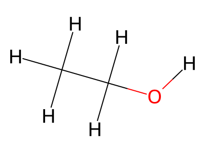

酒精（乙醇）的化學式是 C2H6O：2 個碳、6 個氫、1 個氧，加起來 9 個原子。可是 RDKit 讀進 `CCO` 之後，卻說酒精只有 3 個原子。另外 6 個氫跑去哪裡了？

## 動手玩

先看小框顯示的原子數，再勾選「顯示氫原子」，下方的結構圖會把氫也畫出來。輸入框裡的 SMILES 一樣可以自己改。

```{=html}
<div class="rdkit-play" data-mode="hs">
<script type="application/json">
{"molecules": [
  {"name": "酒精（乙醇）", "smiles": "CCO"},
  {"name": "甲烷（天然氣的主要成分）", "smiles": "C"},
  {"name": "水", "smiles": "O"},
  {"name": "醋酸（乙酸）", "smiles": "CC(=O)O"},
  {"name": "二氧化碳", "smiles": "O=C=O"}
]}
</script>
<figure class="rdkit-play-fallback">

<figcaption>把氫畫出來的酒精：不算氫是 3 個原子，加上氫是 9 個。</figcaption>
</figure>
</div>
```

## 剛才發生什麼事？

SMILES 平常不寫氫。RDKit 讀進分子時，會依照每種原子通常接幾根鍵，算出每個原子身上該有幾個氫。這些氫只記在原子身上，不算成獨立的原子，叫做 **隱含氫**（implicit hydrogen）。

`AddHs` 會把隱含氫變成真正的原子，所以酒精從 3 個原子變成 9 個，甲烷從 1 個變成 5 個。`RemoveHs` 則把這些氫收回去。二氧化碳本來就沒有氫，加不加都是 3 個。

為什麼平常不畫氫？分子一大，氫會擠滿整張圖，反而看不清楚骨架。化學課本的結構式也常省略碳上的氫，道理一樣。真的需要氫的時候，例如要做出分子的立體形狀，再用 `AddHs` 加上去就好。

## 真正的程式

```python
from rdkit import Chem

mol = Chem.MolFromSmiles("CCO")
mol_h = Chem.AddHs(mol)
print(Chem.MolToSmiles(mol_h))                 # [H]OC([H])([H])C([H])([H])[H]
print(Chem.MolToSmiles(Chem.RemoveHs(mol_h)))  # CCO
```

加上氫之後再寫成 SMILES，每個氫都會以 `[H]` 出現；收回去之後又變回 `CCO`。

[](https://colab.research.google.com/github/517justin/cheminfo-blog/blob/main/posts/2026-11-rdkit-04-addhs/ep04.ipynb)
[下載這一集的 notebook](ep04.ipynb)

## 換你試

- 選甲烷，勾選「顯示氫原子」，數數看是不是 5 個原子。
- 把程式裡的 `"CCO"` 換成 `"CC(=O)O"`（醋酸），看看會多出幾個 `[H]`。

## 延伸閱讀

- 《化學資訊學入門》[取得原子、鍵、環的資訊](https://517justin.github.io/cheminfo-intro/chapters/ch02/02-02-atoms-bonds-rings.html)
- RDKit 官方文件：[Modifying molecules](https://www.rdkit.org/docs/GettingStartedInPython.html#modifying-molecules)
