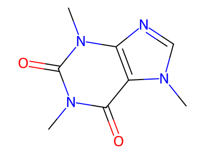

酒精（乙醇）的原子很好數：2 個碳、1 個氧，再加 6 個氫。換成咖啡因，兩個環、四個氮、一堆甲基，用手數很容易漏掉一兩個。這種事交給電腦，又快又不會數錯。

## 動手玩

從選單挑一個分子，或在輸入框改 SMILES，下方會顯示原子和鍵的數量。勾選「把氫也算進去」，數字和結構圖都會一起變。

```{=html}
<div class="rdkit-play" data-mode="count">
<script type="application/json">
{"toggles": ["hcount"],
 "molecules": [
  {"name": "酒精（乙醇）", "smiles": "CCO"},
  {"name": "二氧化碳", "smiles": "O=C=O"},
  {"name": "咖啡因", "smiles": "CN1C=NC2=C1C(=O)N(C(=O)N2C)C"},
  {"name": "葡萄糖", "smiles": "OC[C@H]1OC(O)[C@H](O)[C@@H](O)[C@@H]1O"}
]}
</script>
<figure class="rdkit-play-fallback">

<figcaption>咖啡因不算氫有 14 個原子、15 個鍵。</figcaption>
</figure>
</div>
```

## 剛才發生什麼事？

`GetNumAtoms` 數原子，`GetNumBonds` 數鍵。預設不把氫算進去，因為 SMILES 本來就不寫氫；勾選之後才會加上氫。酒精（乙醇）不算氫是 3 個原子、2 個鍵，把氫算進去變成 9 個原子、8 個鍵。

鍵的算法是「兩個原子之間有一條連線，就算一個鍵」，雙鍵也只算一個。所以二氧化碳是 3 個原子、2 個鍵，不是 4 個鍵。

咖啡因有 14 個原子，鍵卻有 15 個，比原子還多。原因是咖啡因有兩個環：一條沒有分岔的鏈，鍵數是原子數減一；每多一個環，就多一根把頭尾接起來的鍵。分子裡有幾個環，RDKit 也能直接算出來。

## 真正的程式

```python
from rdkit import Chem

for smi in ["CCO", "CN1C=NC2=C1C(=O)N(C(=O)N2C)C"]:
    mol = Chem.MolFromSmiles(smi)
    print(mol.GetNumAtoms(), mol.GetNumBonds())
```

印出 `3 2` 和 `14 15`。

[](https://colab.research.google.com/github/517justin/cheminfo-blog/blob/main/posts/2026-11-rdkit-05-getnumatoms/ep05.ipynb)
[下載這一集的 notebook](ep05.ipynb)

## 換你試

- 選二氧化碳，確認是 3 個原子、2 個鍵。
- 選葡萄糖，原子和鍵都是 12 個。葡萄糖只有一個環，所以鍵數比原子數減一多了 1。

## 延伸閱讀

- 《化學資訊學入門》[取得原子、鍵、環的資訊](https://517justin.github.io/cheminfo-intro/chapters/ch02/02-02-atoms-bonds-rings.html)
- RDKit 官方文件：[Working with Molecules](https://www.rdkit.org/docs/GettingStartedInPython.html#working-with-molecules)
