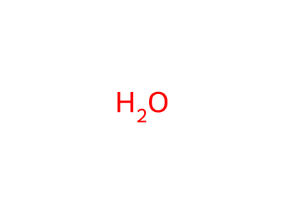

化學課算分子量的步驟是：查原子量，乘上原子的個數，再全部加起來。水是 H2O，2 個氫加 1 個氧，1.008 × 2 + 15.999 ≈ 18.02。水只有 3 個原子，算起來很輕鬆；砂糖（蔗糖）是 C12H22O11，一共 45 個原子，按計算機很容易按錯一個數字。

## 動手玩

從選單挑一個分子，或在輸入框改 SMILES，下方會顯示分子式和分子量。表格列出每種元素有幾個、每個原子多重，最下面一行就是加起來的分子量。

```{=html}
<div class="rdkit-play" data-mode="formula">
<script type="application/json">
{"molecules": [
  {"name": "水", "smiles": "O"},
  {"name": "二氧化碳", "smiles": "O=C=O"},
  {"name": "酒精（乙醇）", "smiles": "CCO"},
  {"name": "葡萄糖", "smiles": "OC[C@H]1OC(O)[C@H](O)[C@@H](O)[C@@H]1O"},
  {"name": "蔗糖（砂糖）", "smiles": "OC[C@H]1O[C@@](CO)(O[C@H]2O[C@H](CO)[C@@H](O)[C@H](O)[C@H]2O)[C@@H](O)[C@@H]1O"},
  {"name": "咖啡因", "smiles": "CN1C=NC2=C1C(=O)N(C(=O)N2C)C"}
]}
</script>
<figure class="rdkit-play-fallback">

<figcaption>水的分子式是 H2O，分子量 18.02。</figcaption>
</figure>
</div>
```

## 剛才發生什麼事？

電腦做的事和手算一樣，只是不會按錯。`CalcMolFormula` 先數出每種元素各有幾個，寫成 **分子式**（molecular formula）。SMILES 沒有寫出氫，RDKit 會自己補上再一起數，所以酒精（乙醇）的 `CCO` 會得到 C2H6O。

分子式的排列順序有固定規則：有碳的分子，碳寫第一個、氫寫第二個，其他元素照英文字母排。所以咖啡因寫成 C8H10N4O2，氮排在氧前面。

`MolWt` 接著查原子量表，把每個原子的質量加起來，就是表格最下面那一行。表格裡碳是 12.011、氧是 15.999，這是自然界各種同位素平均起來的原子量。課本常把它們四捨五入成 12 和 16，所以算出來的數字會差一點點。

## 真正的程式

```python
from rdkit import Chem
from rdkit.Chem import Descriptors, rdMolDescriptors

mol = Chem.MolFromSmiles("CCO")
print(rdMolDescriptors.CalcMolFormula(mol))
print(round(Descriptors.MolWt(mol), 2))
```

印出 `C2H6O` 和 `46.07`。`round(…, 2)` 是把數字四捨五入到小數點後兩位。

[](https://colab.research.google.com/github/517justin/cheminfo-blog/blob/main/posts/2026-11-rdkit-06-molwt/ep06.ipynb)
[下載這一集的 notebook](ep06.ipynb)

## 換你試

- 選葡萄糖和蔗糖（砂糖），比比看哪個比較重。
- 蔗糖是一個葡萄糖和一個果糖接起來的，果糖的分子量和葡萄糖一樣，都是 180.16。兩個加起來是 360.32，蔗糖卻只有 342.30，差了 18.02。這個數字很眼熟：剛好是一個水分子。兩個糖接在一起時，會少掉一個水。

## 延伸閱讀

- 《化學資訊學入門》[常用物化描述符（分子量、logP、TPSA）](https://517justin.github.io/cheminfo-intro/chapters/ch04/04-02-physicochemical-descriptors.html)
- RDKit 官方文件：[Descriptor Calculation](https://www.rdkit.org/docs/GettingStartedInPython.html#descriptor-calculation)
