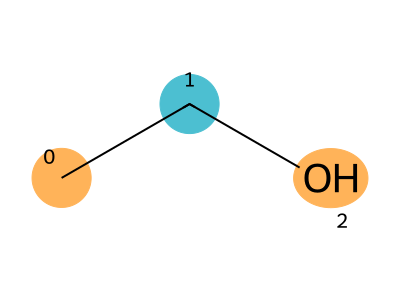

酒精（乙醇）的 `CCO` 裡，中間那個碳左邊接一個碳、右邊接一個氧。看結構式時，順著線就看得出來。電腦裡的分子沒有圖可以看，要知道一個原子接了誰，得直接問那個原子。

## 動手玩

從選單挑一個分子，或在輸入框改 SMILES，再點下方的原子編號。圖上的顏色只標在原子上：藍綠色是選到的原子，橘色是它的鄰居，也就是和它直接相連的原子。上方會用文字列出鄰居是誰。勾選「顯示氫原子」，氫也會變成可以點的原子。

```{=html}
<div class="rdkit-play" data-mode="neighbors">
<script type="application/json">
{"toggles": ["hs"],
 "molecules": [
  {"name": "酒精（乙醇）", "smiles": "CCO"},
  {"name": "異丙醇", "smiles": "CC(C)O"},
  {"name": "醋酸（乙酸）", "smiles": "CC(=O)O"},
  {"name": "咖啡因", "smiles": "CN1C=NC2=C1C(=O)N(C(=O)N2C)C"}
]}
</script>
<figure class="rdkit-play-fallback">

<figcaption>藍綠色是選到的 1 號碳，橘色是它的 2 個鄰居：0 號碳和 2 號氧。</figcaption>
</figure>
</div>
```

## 剛才發生什麼事？

RDKit 用編號記住每個原子，再用一張「誰和誰相連」的清單記住每個鍵。`GetNeighbors` 會查這張清單，把和某個原子直接相連的原子都找出來，這些原子就是它的 **鄰居**（neighbor）。`GetDegree` 則只回答鄰居有幾個。

酒精（乙醇）的 1 號碳有 2 個鄰居：0 號碳和 2 號氧。換成異丙醇，中間的碳同時接了兩個碳和一個氧，鄰居變成 3 個。

氫要另外看。SMILES 沒有寫出氫，RDKit 只在每個原子身上記一個「接了幾個氫」的數字，不把它們當成獨立的原子，所以不算在鄰居裡。勾選「顯示氫原子」後，氫變成真正的原子，酒精的 1 號碳鄰居就從 2 個變成 4 個。

## 真正的程式

```python
from rdkit import Chem

mol = Chem.MolFromSmiles("CCO")
atom = mol.GetAtomWithIdx(1)
print(atom.GetSymbol(), atom.GetDegree())
print([n.GetIdx() for n in atom.GetNeighbors()])
print(atom.GetTotalNumHs())
```

`GetAtomWithIdx(1)` 是拿出 1 號原子。三行分別印出 `C 2`（碳，有 2 個鄰居）、`[0, 2]`（鄰居是 0 號和 2 號）、`2`（另外接了 2 個氫）。

[](https://colab.research.google.com/github/517justin/cheminfo-blog/blob/main/posts/2026-11-rdkit-07-getneighbors/ep07.ipynb)
[下載這一集的 notebook](ep07.ipynb)

## 換你試

- 選咖啡因，找一個有 3 個鄰居的氮。
- 選醋酸（乙酸），點 1 號碳。它的鄰居裡有一個氧用雙鍵相連，鄰居的數量會因此多算一個嗎？

## 延伸閱讀

- 《化學資訊學入門》[取得原子、鍵、環的資訊](https://517justin.github.io/cheminfo-intro/chapters/ch02/02-02-atoms-bonds-rings.html)
- RDKit 官方文件：[Looping over Atoms and Bonds](https://www.rdkit.org/docs/GettingStartedInPython.html#looping-over-atoms-and-bonds)
