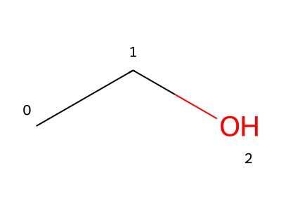

看結構式的時候，C 是碳、O 是氧、N 是氮，一眼就認得出來。電腦沒有在看圖，在電腦裡，分子是一份原子的清單，每個原子有自己的編號，也記著自己是哪一種元素。

## 動手玩

從選單挑一個分子，或在輸入框改 SMILES，下方表格會列出每個原子的編號和元素，結構圖上的小數字就是編號。點表格裡的一列，圖上會塗出那個原子。勾選「顯示氫原子」，氫也會加進清單。

```{=html}
<div class="rdkit-play" data-mode="atoms">
<script type="application/json">
{"toggles": ["hs"],
 "molecules": [
  {"name": "酒精（乙醇）", "smiles": "CCO"},
  {"name": "醋酸（乙酸）", "smiles": "CC(=O)O"},
  {"name": "尿素", "smiles": "NC(N)=O"},
  {"name": "咖啡因", "smiles": "CN1C=NC2=C1C(=O)N(C(=O)N2C)C"}
]}
</script>
<figure class="rdkit-play-fallback">

<figcaption>酒精（乙醇）的三個原子：0 號和 1 號是碳，2 號是氧。</figcaption>
</figure>
</div>
```

## 剛才發生什麼事？

`GetAtoms` 把分子裡的原子一個一個拿出來。每個原子用 `GetIdx` 問編號，用 `GetSymbol` 問元素符號。

編號從 0 開始，順序就是原子在 SMILES 裡出現的先後。`CCO` 的第一個 C 是 0 號，第二個 C 是 1 號，O 是 2 號。程式裡的編號大多從 0 開始數，RDKit 也一樣。

勾選「顯示氫原子」後，氫會接在清單最後面。酒精（乙醇）原本有 3 個原子，加上 6 個氫變成 9 個，氫的編號是 3 到 8。

有了編號，就能指定「哪一個原子」，例如把某個原子塗上顏色、找出某個原子旁邊接了誰。之後找結構、改結構，都要靠這些編號。

## 真正的程式

```python
from rdkit import Chem

mol = Chem.MolFromSmiles("CCO")
for atom in mol.GetAtoms():
    print(atom.GetIdx(), atom.GetSymbol())
```

印出三行：`0 C`、`1 C`、`2 O`。

[](https://colab.research.google.com/github/517justin/cheminfo-blog/blob/main/posts/2026-11-rdkit-08-getatoms/ep08.ipynb)
[下載這一集的 notebook](ep08.ipynb)

## 換你試

- 選咖啡因，數數看有幾個氮，編號各是多少。
- 把輸入框改成 `OCC`，酒精（乙醇）的編號順序會怎麼變？

## 延伸閱讀

- 《化學資訊學入門》[取得原子、鍵、環的資訊](https://517justin.github.io/cheminfo-intro/chapters/ch02/02-02-atoms-bonds-rings.html)
- RDKit 官方文件：[Looping over Atoms and Bonds](https://www.rdkit.org/docs/GettingStartedInPython.html#looping-over-atoms-and-bonds)
