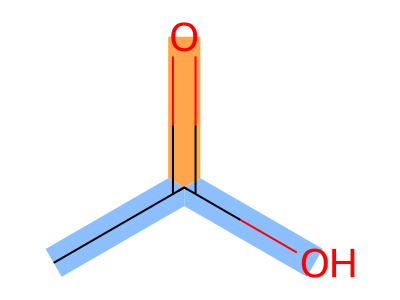

二氧化碳的碳和氧之間是雙鍵，乙炔（電石氣）的兩個碳之間是三鍵。SMILES 用符號區分：什麼都不寫是單鍵，`=` 是雙鍵，`#` 是三鍵。電腦讀進來之後，每一個鍵都會記住自己是哪一種。

## 動手玩

從選單挑一個分子，或在輸入框改 SMILES，結構圖上的鍵會依種類塗上不同顏色，上方列出每種鍵各有幾個。

```{=html}
<div class="rdkit-play" data-mode="bonds">
<script type="application/json">
{"molecules": [
  {"name": "醋酸（乙酸）", "smiles": "CC(=O)O"},
  {"name": "酒精（乙醇）", "smiles": "CCO"},
  {"name": "二氧化碳", "smiles": "O=C=O"},
  {"name": "乙烯（讓水果變熟的氣體）", "smiles": "C=C"},
  {"name": "乙炔（電石氣）", "smiles": "C#C"},
  {"name": "苯", "smiles": "c1ccccc1"}
]}
</script>
<figure class="rdkit-play-fallback">

<figcaption>醋酸（乙酸）有 2 個單鍵和 1 個雙鍵。</figcaption>
</figure>
</div>
```

## 剛才發生什麼事？

`GetBonds` 把分子裡的鍵一個一個拿出來，`GetBondType` 回答這個鍵是哪一種：`SINGLE`（單鍵）、`DOUBLE`（雙鍵）或 `TRIPLE`（三鍵）。小框就是照這個答案塗顏色。

苯是第四種情況。苯環的六個鍵長度都一樣，介於單鍵和雙鍵之間，RDKit 把這種鍵歸成另一類：**芳香鍵**（aromatic bond），答案是 `AROMATIC`。小框把芳香鍵畫成一實一虛的線，塗成綠色。

鍵的數量和原子一樣，不算氫。醋酸（乙酸）的 `CC(=O)O` 有 4 個原子、3 個鍵：碳碳單鍵、碳氧雙鍵，再加上碳和 OH 之間的單鍵。

## 真正的程式

```python
from rdkit import Chem

for smi in ["CCO", "O=C=O", "C#C"]:
    mol = Chem.MolFromSmiles(smi)
    print(smi, [str(b.GetBondType()) for b in mol.GetBonds()])
```

印出 `['SINGLE', 'SINGLE']`、`['DOUBLE', 'DOUBLE']`、`['TRIPLE']`。

[](https://colab.research.google.com/github/517justin/cheminfo-blog/blob/main/posts/2026-11-rdkit-09-getbonds/ep09.ipynb)
[下載這一集的 notebook](ep09.ipynb)

## 換你試

- 選苯，看看六個鍵都是什麼顏色。
- 在輸入框打 `C=CC=C`（丁二烯），單鍵和雙鍵各有幾個？

## 延伸閱讀

- 《化學資訊學入門》[取得原子、鍵、環的資訊](https://517justin.github.io/cheminfo-intro/chapters/ch02/02-02-atoms-bonds-rings.html)
- RDKit 官方文件：[Looping over Atoms and Bonds](https://www.rdkit.org/docs/GettingStartedInPython.html#looping-over-atoms-and-bonds)
