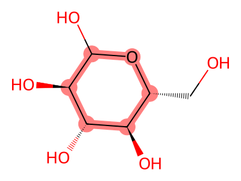

葡萄糖畫出來有一個六角形，咖啡因有一個五角形和一個六角形連在一起，酒精（乙醇）則是一條直直的鏈。我們一看就知道哪些原子圍成一圈，電腦是怎麼知道的？

## 動手玩

從選單挑一個分子，或在輸入框改 SMILES，下方會顯示有幾個環，環上的原子會塗上顏色。

```{=html}
<div class="rdkit-play" data-mode="rings">
<script type="application/json">
{"molecules": [
  {"name": "葡萄糖", "smiles": "OC[C@H]1OC(O)[C@H](O)[C@@H](O)[C@@H]1O"},
  {"name": "咖啡因", "smiles": "CN1C=NC2=C1C(=O)N(C(=O)N2C)C"},
  {"name": "蔗糖（砂糖）", "smiles": "OC[C@H]1O[C@@](CO)(O[C@H]2O[C@H](CO)[C@@H](O)[C@H](O)[C@H]2O)[C@@H](O)[C@@H]1O"},
  {"name": "苯", "smiles": "c1ccccc1"},
  {"name": "酒精（乙醇）", "smiles": "CCO"}
]}
</script>
<figure class="rdkit-play-fallback">

<figcaption>葡萄糖有 1 個環，環上的原子已經塗上顏色。</figcaption>
</figure>
</div>
```

## 剛才發生什麼事？

線索就藏在 SMILES 的數字裡。環的開頭和結尾會標上同一個數字，例如苯寫成 `c1ccccc1`，第一個 `c` 和最後一個 `c` 都帶著 `1`，代表這兩個原子要接起來，六個碳就圍成一圈。

RDKit 讀進分子之後，會用 `GetRingInfo` 記下每個環由哪些原子組成，`NumRings` 則告訴你一共有幾個環。葡萄糖是 1 個，咖啡因是 2 個；咖啡因的兩個環共用兩個原子，所以畫起來像黏在一起。酒精（乙醇）沒有環，小框就不會塗色。

咖啡因的鍵（15 個）比原子（14 個）多，也是因為這兩個環：每多一個環，就多一根把頭尾接起來的鍵。

## 真正的程式

```python
from rdkit import Chem

for smi in ["OC[C@H]1OC(O)[C@H](O)[C@@H](O)[C@@H]1O", "CN1C=NC2=C1C(=O)N(C(=O)N2C)C"]:
    mol = Chem.MolFromSmiles(smi)
    print(mol.GetRingInfo().NumRings())
```

印出 `1` 和 `2`，分別是葡萄糖和咖啡因。

[](https://colab.research.google.com/github/517justin/cheminfo-blog/blob/main/posts/2026-11-rdkit-10-getringinfo/ep10.ipynb)
[下載這一集的 notebook](ep10.ipynb)

## 換你試

- 選蔗糖（砂糖），看看是不是 2 個環。蔗糖由一個葡萄糖和一個果糖接在一起。
- 在輸入框打 `C1CCCCC1`（環己烷），再打 `CCCCCC`（己烷），比較有沒有數字 1 的差別。

## 延伸閱讀

- 《化學資訊學入門》[取得原子、鍵、環的資訊](https://517justin.github.io/cheminfo-intro/chapters/ch02/02-02-atoms-bonds-rings.html)
- RDKit 官方文件：[Ring Information](https://www.rdkit.org/docs/GettingStartedInPython.html#ring-information)
