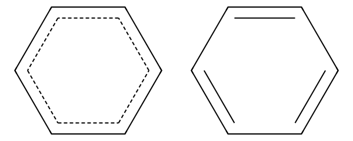

課本上的苯有兩種畫法：一種是六角形裡面單鍵、雙鍵輪流排，這是十九世紀的化學家凱庫勒（August Kekulé）提出的；另一種是六角形中間畫一個圓圈。SMILES 也有兩種寫法：大寫加雙鍵的 `C1=CC=CC=C1`，和全部小寫的 `c1ccccc1`。這兩種寫的是同一個苯嗎？

## 動手玩

從選單挑一個分子，或在輸入框改 SMILES。下方左右兩邊是同一個分子：左邊是電腦讀進來後的芳香寫法，右邊是換成單雙鍵交替的寫法，各附上 SMILES。

```{=html}
<div class="rdkit-play" data-mode="kekule">
<script type="application/json">
{"molecules": [
  {"name": "苯（小寫的芳香寫法）", "smiles": "c1ccccc1"},
  {"name": "苯（單雙鍵交替寫法）", "smiles": "C1=CC=CC=C1"},
  {"name": "阿斯匹靈", "smiles": "CC(=O)Oc1ccccc1C(=O)O"},
  {"name": "咖啡因", "smiles": "CN1C=NC2=C1C(=O)N(C(=O)N2C)C"},
  {"name": "酒精（乙醇）", "smiles": "CCO"}
]}
</script>
<figure class="rdkit-play-fallback">

<figcaption>同一個苯的兩種寫法：芳香寫法 c1ccccc1 和單雙鍵交替寫法 C1=CC=CC=C1。</figcaption>
</figure>
</div>
```

## 剛才發生什麼事？

選單裡的兩種苯，左邊的結果完全一樣。RDKit 讀 SMILES 時會檢查每個環，符合條件的環就判斷成芳香環，整理後的 SMILES 用小寫字母表示。所以不管輸入哪一種寫法，電腦裡存的都是同一個苯。

右邊用的是 `Kekulize`，作用剛好相反：把芳香環換回單鍵、雙鍵輪流排的寫法，這種寫法叫做 **凱庫勒式**（Kekulé structure）。有些軟體和檔案格式不認得芳香鍵，只接受凱庫勒式，就需要先轉換。

實際上苯的六個鍵一樣長，沒有哪一個特別像雙鍵。兩種寫法都只是記錄方式，描述的是同一個分子。

## 真正的程式

```python
from rdkit import Chem

mol = Chem.MolFromSmiles("c1ccccc1")
Chem.Kekulize(mol, clearAromaticFlags=True)
print(Chem.MolToSmiles(mol))
```

印出 `C1=CC=CC=C1`。`clearAromaticFlags=True` 是叫 RDKit 連「這是芳香環」的標記也一起拿掉，寫出來的 SMILES 才會變成大寫加雙鍵。

[](https://colab.research.google.com/github/517justin/cheminfo-blog/blob/main/posts/2026-11-rdkit-11-kekulize/ep11.ipynb)
[下載這一集的 notebook](ep11.ipynb)

## 換你試

- 選阿斯匹靈，左右兩邊比一比：哪一部分寫法不同，哪一部分完全一樣？
- 選酒精（乙醇），沒有芳香環的分子，左右兩邊會有差別嗎？

## 延伸閱讀

- 《化學資訊學入門》[SMILES](https://517justin.github.io/cheminfo-intro/chapters/ch01/01-02-smiles.html)
- RDKit 官方文件：[Writing molecules](https://www.rdkit.org/docs/GettingStartedInPython.html#writing-molecules)
