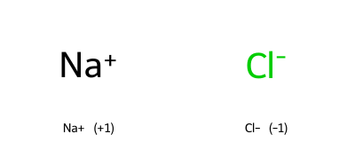

食鹽是氯化鈉，由帶正電的鈉離子和帶負電的氯離子組成。鈉和氯之間不是共用電子的化學鍵，而是正負電互相吸引。這種東西要怎麼寫成 SMILES，電腦又會怎麼理解？

## 動手玩

從選單挑一個物質，或在輸入框改 SMILES，下方會把它拆成一塊一塊，每塊標出分子式和電荷。

```{=html}
<div class="rdkit-play" data-mode="ions">
<script type="application/json">
{"molecules": [
  {"name": "食鹽（氯化鈉）", "smiles": "[Na+].[Cl-]"},
  {"name": "小蘇打（碳酸氫鈉）", "smiles": "[Na+].OC([O-])=O"},
  {"name": "醋酸鈉", "smiles": "CC(=O)[O-].[Na+]"},
  {"name": "氯化鈣（除濕盒裡的白色顆粒）", "smiles": "[Ca+2].[Cl-].[Cl-]"},
  {"name": "酒精（乙醇）", "smiles": "CCO"}
]}
</script>
<figure class="rdkit-play-fallback">

<figcaption>食鹽 [Na+].[Cl-] 拆成鈉離子和氯離子兩塊。</figcaption>
</figure>
</div>
```

## 剛才發生什麼事？

食鹽的 SMILES 是 `[Na+].[Cl-]`，裡面有兩個新規則。

第一個是方括號。原子可以寫在方括號裡，並在後面加上電荷：`[Na+]` 是帶一個正電的鈉，`[Cl-]` 是帶一個負電的氯，`[Ca+2]` 是帶兩個正電的鈣。RDKit 用 `GetFormalCharge` 讀出每個原子的電荷。

第二個是句點 `.`，意思是兩邊沒有用化學鍵連在一起。`GetMolFrags` 會找出分子裡彼此不相連的部分，食鹽拆成 2 塊，氯化鈣拆成 3 塊。

每塊的電荷加起來是 0，整個物質不帶電。小蘇打（碳酸氫鈉）的負電不在碳上，而是在其中一個氧上，所以 SMILES 寫成 `[O-]`。

藥品的資料常常是「藥物分子加上一個小離子」的鹽類，例如鹽酸鹽。整理資料時，常要先用 `GetMolFrags` 把分子拆開，只留下主要的那一塊。

## 真正的程式

```python
from rdkit import Chem

mol = Chem.MolFromSmiles("[Na+].[Cl-]")
for atom in mol.GetAtoms():
    print(atom.GetSymbol(), atom.GetFormalCharge())
print(len(Chem.GetMolFrags(mol)))
```

印出 `Na 1`、`Cl -1`，最後一行的 `2` 代表拆成兩塊。

[](https://colab.research.google.com/github/517justin/cheminfo-blog/blob/main/posts/2026-11-rdkit-12-getmolfrags/ep12.ipynb)
[下載這一集的 notebook](ep12.ipynb)

## 換你試

- 選小蘇打（碳酸氫鈉），拆成幾塊？負電在哪一個原子上？
- 選氯化鈣，3 塊的電荷加起來是多少？

## 延伸閱讀

- 《化學資訊學入門》[分子標準化與去鹽](https://517justin.github.io/cheminfo-intro/chapters/ch02/02-04-standardization-and-salts.html)
- RDKit 官方文件：[Looping over Atoms and Bonds](https://www.rdkit.org/docs/GettingStartedInPython.html#looping-over-atoms-and-bonds)
