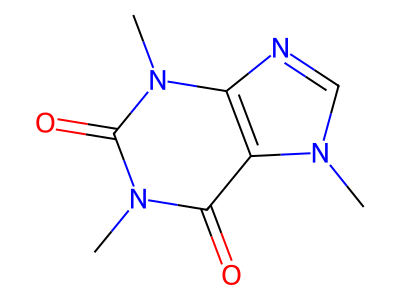

*《用 RDKit 玩化學》第 13 集*

前面每一集的小框都有一張結構圖，這些圖都是 RDKit 畫的。可是 SMILES 只告訴電腦哪些原子連在一起，沒有說每個原子要放在紙上的哪個位置。電腦怎麼把一串字變成一張圖？

## 動手玩

從選單挑一個分子，或在輸入框貼上你知道的 SMILES，結構圖會畫在下方。畫出來之後，再試試「換一種排法」和「顯示氫原子」這兩個勾選框。

```{=html}
<div class="rdkit-play" data-mode="draw">
<script type="application/json">
{"toggles": ["coordgen", "hs"],
 "molecules": [
  {"name": "咖啡因", "smiles": "CN1C=NC2=C1C(=O)N(C(=O)N2C)C"},
  {"name": "酒精（乙醇）", "smiles": "CCO"},
  {"name": "葡萄糖", "smiles": "OC[C@H]1OC(O)[C@H](O)[C@@H](O)[C@@H]1O"},
  {"name": "蔗糖（砂糖）", "smiles": "OC[C@H]1O[C@@](CO)(O[C@H]2O[C@H](CO)[C@@H](O)[C@H](O)[C@H]2O)[C@@H](O)[C@@H]1O"},
  {"name": "小蘇打（碳酸氫鈉）", "smiles": "[Na+].OC([O-])=O"}
]}
</script>
<figure class="rdkit-play-fallback">

<figcaption>RDKit 畫出的咖啡因。</figcaption>
</figure>
</div>
```

## 剛才發生什麼事？

RDKit 畫圖分兩步。第一步，替每個原子算出一組平面座標，讓鍵長差不多、角度好看、原子不會疊在一起。第二步，照著座標把原子和鍵畫出來。

座標是電腦算出來的，SMILES 裡並沒有寫。勾選「換一種排法」，RDKit 會改用另一套叫 CoordGen 的方法排座標，同一個分子就畫成另一個樣子，但原子之間怎麼連接完全沒變。

畫法採用化學課本常見的 **鍵線式**（skeletal formula）：碳原子不寫字，只用線的轉折和端點表示；碳上的氫省略；其他元素才寫出元素符號，並用顏色區分，氧是紅色、氮是藍色。選酒精（乙醇）來看，圖上只寫了 OH，兩個碳藏在線的端點和轉折處。再勾選「顯示氫原子」，原本省略的氫就會全部畫出來。

選小蘇打（碳酸氫鈉），畫出來是分開的兩塊，因為小蘇打由鈉離子和碳酸氫根離子組成，兩者之間沒有共用的鍵。

## 真正的程式

```python
from rdkit import Chem
from rdkit.Chem import Draw

mol = Chem.MolFromSmiles("CN1C=NC2=C1C(=O)N(C(=O)N2C)C")
Draw.MolToFile(mol, "caffeine.png")   # 存成圖檔
Draw.MolToImage(mol)                  # 在 Colab 或 Jupyter 裡直接顯示
```

`MolToFile` 會在資料夾裡存一張 `caffeine.png`，放進報告或簡報都很方便。

[](https://colab.research.google.com/github/517justin/cheminfo-blog/blob/main/posts/2026-11-rdkit-13-moltoimage/ep13.ipynb)
[下載這一集的 notebook](ep13.ipynb)

## 換你試

- 把最後一行改成 `Draw.MolToImage(mol, size=(600, 400))`，圖會變大。
- 在小框裡選蔗糖，看看蔗糖是不是由兩個環接在一起，再勾選「換一種排法」，比較兩種畫法哪一種比較好讀。

## 延伸閱讀

- 《化學資訊學入門》[讀寫與畫出分子](https://517justin.github.io/cheminfo-intro/chapters/ch02/02-01-read-write-draw.html)
- RDKit 官方文件：[Drawing molecules](https://www.rdkit.org/docs/GettingStartedInPython.html#drawing-molecules)
