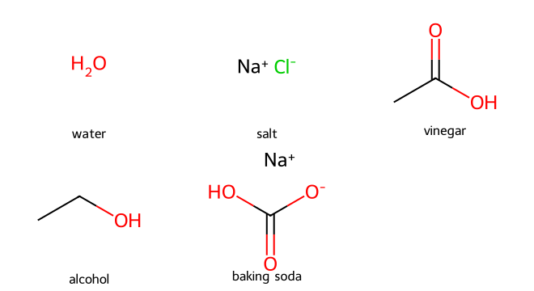

廚房裡就有不少化學：水、食鹽、醋、米酒、小蘇打、砂糖。想把它們的結構放在一起比較，一個一個畫再拼起來太麻煩，RDKit 可以一次畫成一張表格。

## 動手玩

勾選想要排進來的分子，選「每一排放幾個」，下方就會排成格子，每格下面寫著名稱。也可以在輸入框打 SMILES，按「加入」放進自己的分子。

```{=html}
<div class="rdkit-play" data-mode="grid">
<script type="application/json">
{"selected": [0, 1, 2, 3, 4, 5], "perRow": 3,
 "molecules": [
  {"name": "水", "smiles": "O"},
  {"name": "食鹽（氯化鈉）", "smiles": "[Na+].[Cl-]"},
  {"name": "醋酸（乙酸）", "smiles": "CC(=O)O"},
  {"name": "酒精（乙醇）", "smiles": "CCO"},
  {"name": "小蘇打（碳酸氫鈉）", "smiles": "[Na+].OC([O-])=O"},
  {"name": "蔗糖（砂糖）", "smiles": "OC[C@H]1O[C@@](CO)(O[C@H]2O[C@H](CO)[C@@H](O)[C@H](O)[C@H]2O)[C@@H](O)[C@@H]1O"},
  {"name": "葡萄糖", "smiles": "OC[C@H]1OC(O)[C@H](O)[C@@H](O)[C@@H]1O"},
  {"name": "咖啡因", "smiles": "CN1C=NC2=C1C(=O)N(C(=O)N2C)C"}
]}
</script>
<figure class="rdkit-play-fallback">

<figcaption>水、食鹽、醋酸、酒精、小蘇打排成兩排，第一排 3 個、第二排 2 個。</figcaption>
</figure>
</div>
```

## 剛才發生什麼事？

`MolsToGridImage` 會把一串分子排成格子，畫成一張圖。

- 第一個參數是分子的清單。
- `molsPerRow` 決定每一排放幾個。
- `legends` 是每一格下面的名稱，順序和分子的清單一一對應。

小框裡的「每一排放幾個」，就是在改 `molsPerRow`。

排成一張圖的好處是方便比較：醋酸和酒精都只有 2 個碳，差別只在醋酸多了一個雙鍵相連的氧；砂糖比其他分子大得多。

有一個小地方要注意：在 Python 裡，`legends` 寫中文的話，字會整個消失，所以程式裡的名稱用英文。小框是網頁畫的，名稱寫在格子外面，就能用中文。

## 真正的程式

```python
from rdkit import Chem
from rdkit.Chem import Draw

smiles = ["O", "[Na+].[Cl-]", "CC(=O)O", "CCO", "[Na+].OC([O-])=O"]
names = ["water", "salt", "vinegar", "alcohol", "baking soda"]
Draw.MolsToGridImage([Chem.MolFromSmiles(s) for s in smiles], legends=names, molsPerRow=3)
```

在 Colab 或 Jupyter 裡會畫出一張兩排的圖，第一排 3 個、第二排 2 個。

[](https://colab.research.google.com/github/517justin/cheminfo-blog/blob/main/posts/2026-11-rdkit-14-molstogridimage/ep14.ipynb)
[下載這一集的 notebook](ep14.ipynb)

## 換你試

- 把「每一排放幾個」改成 2，看看排法怎麼變。
- 把程式裡的 `molsPerRow=3` 改成 `2`，結果和小框一樣嗎？

## 延伸閱讀

- 《化學資訊學入門》[讀寫與畫出分子](https://517justin.github.io/cheminfo-intro/chapters/ch02/02-01-read-write-draw.html)
- RDKit 官方文件：[Drawing Molecules](https://www.rdkit.org/docs/GettingStartedInPython.html#drawing-molecules)
