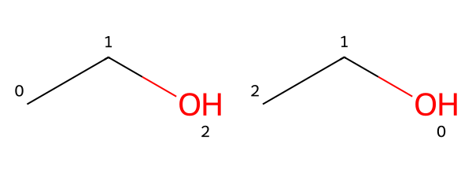

RDKit 會替分子裡的每個原子編號，要指定「哪一個原子」時就靠這些編號。編號平常看不到，畫圖時可以請 RDKit 把它標出來。不過同一個分子寫法不同，編號也會跟著變。

## 動手玩

從選單挑一個分子，左右兩邊是同一個分子的兩種 SMILES 寫法，結構圖上標出原子編號。勾選「顯示鍵的編號」，鍵的中間也會標上編號。也可以直接改左右兩個輸入框。

```{=html}
<div class="rdkit-play" data-mode="pairdraw">
<script type="application/json">
{"pairs": [
  {"name": "酒精（乙醇）：CCO 和 OCC", "a": "CCO", "b": "OCC"},
  {"name": "醋酸（乙酸）：CC(=O)O 和 OC(C)=O", "a": "CC(=O)O", "b": "OC(C)=O"},
  {"name": "異丙醇：CC(C)O 和 OC(C)C", "a": "CC(C)O", "b": "OC(C)C"}
]}
</script>
<figure class="rdkit-play-fallback">

<figcaption>同一個酒精（乙醇），CCO 和 OCC 的原子編號順序剛好相反。</figcaption>
</figure>
</div>
```

## 剛才發生什麼事？

畫圖時把 `MolDrawOptions` 裡的 `addAtomIndices` 設成 `True`，每個原子旁邊就會標上編號；`addBondIndices` 則是替鍵標上編號。

編號的規則很單純：照原子在 SMILES 裡出現的順序，從 0 開始數。`CCO` 先寫碳，所以 0 號是碳、2 號是氧；`OCC` 先寫氧，0 號就變成氧。兩種寫法畫出來是同一個分子，編號卻剛好相反。

所以要用編號指定原子時，得先確認分子是用哪一種寫法讀進來的。如果分子先經過電腦整理成固定的寫法，整理後的編號也可能和原本不一樣。

## 真正的程式

```python
from rdkit import Chem
from rdkit.Chem import Draw

opts = Draw.MolDrawOptions()
opts.addAtomIndices = True
Draw.MolToImage(Chem.MolFromSmiles("CCO"), options=opts)
```

畫出酒精（乙醇）的結構圖，三個原子旁邊標著 0、1、2。

[](https://colab.research.google.com/github/517justin/cheminfo-blog/blob/main/posts/2026-11-rdkit-15-addatomindices/ep15.ipynb)
[下載這一集的 notebook](ep15.ipynb)

## 換你試

- 把程式裡的 `"CCO"` 改成 `"OCC"`，看編號怎麼變。
- 在小框勾選「顯示鍵的編號」，醋酸（乙酸）的 3 個鍵各是幾號？

## 延伸閱讀

- 《化學資訊學入門》[讀寫與畫出分子](https://517justin.github.io/cheminfo-intro/chapters/ch02/02-01-read-write-draw.html)
- RDKit 官方文件：[Drawing Molecules](https://www.rdkit.org/docs/GettingStartedInPython.html#drawing-molecules)
