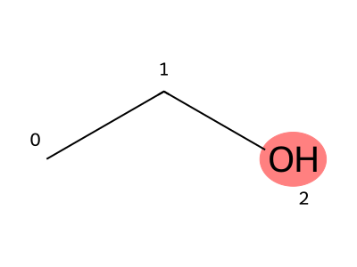

上課講解分子時，常會想把某一部分圈起來，例如「看這裡，這是 OH」。RDKit 畫圖時也能做到：告訴它要塗哪幾個原子，畫出來就會塗上顏色。

## 動手玩

從選單挑一個分子，結構圖上會標出原子編號。在「要塗色的原子編號」輸入編號，例如 `2` 或 `0,1`，那些原子就會塗上顏色。

```{=html}
<div class="rdkit-play" data-mode="pick">
<script type="application/json">
{"pick": "2",
 "molecules": [
  {"name": "酒精（乙醇）", "smiles": "CCO"},
  {"name": "醋酸（乙酸）", "smiles": "CC(=O)O"},
  {"name": "咖啡因", "smiles": "CN1C=NC2=C1C(=O)N(C(=O)N2C)C"}
]}
</script>
<figure class="rdkit-play-fallback">

<figcaption>酒精（乙醇）的 2 號原子是氧，塗上了顏色。</figcaption>
</figure>
</div>
```

## 剛才發生什麼事？

`MolToImage` 有一個參數叫 `highlightAtoms`，放進原子編號的清單，畫出來時這些原子就會塗上顏色。

編號從哪裡來？就是結構圖上標的那些數字：酒精（乙醇）的 `CCO` 裡，2 號原子是氧，所以 `highlightAtoms=[2]` 會塗出氧。輸入超過範圍的編號，例如酒精只有 0 到 2 號，打 5 就找不到原子。

實際使用時，很少一個一個手打編號。比較常見的做法是先讓電腦找出某種結構，例如找出分子裡所有的 OH，再把找到的編號交給 `highlightAtoms` 塗色。

## 真正的程式

```python
from rdkit import Chem
from rdkit.Chem import Draw

mol = Chem.MolFromSmiles("CCO")
Draw.MolToImage(mol, highlightAtoms=[2])   # 2 號原子是氧
```

畫出酒精（乙醇）的結構圖，氧被塗上顏色。

[](https://colab.research.google.com/github/517justin/cheminfo-blog/blob/main/posts/2026-11-rdkit-16-highlightatoms/ep16.ipynb)
[下載這一集的 notebook](ep16.ipynb)

## 換你試

- 在小框輸入 `0,1`，把酒精（乙醇）的兩個碳塗起來。
- 選醋酸（乙酸），找出兩個氧的編號，把它們一起塗色。

## 延伸閱讀

- 《化學資訊學入門》[讀寫與畫出分子](https://517justin.github.io/cheminfo-intro/chapters/ch02/02-01-read-write-draw.html)
- RDKit 官方文件：[Drawing Molecules](https://www.rdkit.org/docs/GettingStartedInPython.html#drawing-molecules)
