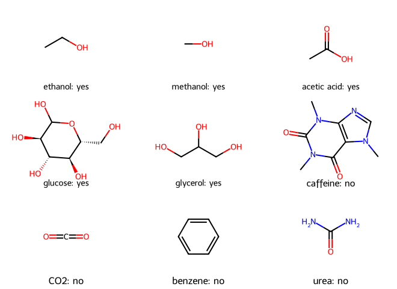

酒精（乙醇）和甲醇都有一個 OH，咖啡因沒有。分子小的時候看一眼就知道，可是要從一萬個分子裡挑出有 OH 的，一個一個看就太累了，這種事交給電腦最適合。

## 動手玩

下面一次排了 9 個分子。在「要找什麼」選 OH，電腦會把每個分子檢查一遍：找得到的亮起來、打勾，找不到的變灰。也可以換成找碳氧雙鍵或氮，或在輸入框打一個 SMILES，按「加入」把自己的分子放進來。

```{=html}
<div class="rdkit-play" data-mode="filter">
<script type="application/json">
{"targets": [
  {"label": "OH", "query": "[OX2H]"},
  {"label": "碳氧雙鍵（C=O）", "query": "[#6]=[#8]"},
  {"label": "氮（N）", "query": "[#7]"}
 ],
 "molecules": [
  {"name": "酒精（乙醇）", "smiles": "CCO"},
  {"name": "甲醇", "smiles": "CO"},
  {"name": "醋酸（乙酸）", "smiles": "CC(=O)O"},
  {"name": "葡萄糖", "smiles": "OC[C@H]1OC(O)[C@H](O)[C@@H](O)[C@@H]1O"},
  {"name": "甘油", "smiles": "OCC(O)CO"},
  {"name": "咖啡因", "smiles": "CN1C=NC2=C1C(=O)N(C(=O)N2C)C"},
  {"name": "二氧化碳", "smiles": "O=C=O"},
  {"name": "苯", "smiles": "c1ccccc1"},
  {"name": "尿素", "smiles": "NC(N)=O"}
]}
</script>
<figure class="rdkit-play-fallback">

<figcaption>9 個分子裡，酒精、甲醇、醋酸、葡萄糖、甘油有 OH。</figcaption>
</figure>
</div>
```

## 剛才發生什麼事？

電腦得先知道「OH」長什麼樣子，所以我們把 OH 寫成搜尋條件 `[OX2H]`，意思是「一個氧，總共接兩樣東西，其中一個是氫」。這個寫法不用記，知道代表 OH 就好。

接著，`HasSubstructMatch` 拿這個條件到每個分子裡逐一比對原子，答案只有「有」或「沒有」，不管有幾個、在哪裡。這種找法叫做 **子結構搜尋**（substructure search）。只要一個是非題，就能把一大堆分子分成兩堆，資料庫裡有幾萬個分子也一樣快。

為什麼不直接找字母 O？二氧化碳、咖啡因和尿素也有氧，但這些氧用雙鍵接在碳上，旁邊沒有氫，不是 OH。換成找碳氧雙鍵，亮起來的就變成醋酸、咖啡因、二氧化碳和尿素。子結構搜尋比對的是原子怎麼連接，不是 SMILES 裡有沒有某個字母。

## 真正的程式

```python
from rdkit import Chem

oh = Chem.MolFromSmarts("[OX2H]")   # 代表 OH 的搜尋條件
molecules = {"酒精": "CCO", "咖啡因": "CN1C=NC2=C1C(=O)N(C(=O)N2C)C",
             "葡萄糖": "OC[C@H]1OC(O)[C@H](O)[C@@H](O)[C@@H]1O", "苯": "c1ccccc1"}
for name, smi in molecules.items():
    print(name, Chem.MolFromSmiles(smi).HasSubstructMatch(oh))
```

酒精和葡萄糖印出 `True`，咖啡因和苯印出 `False`。

[](https://colab.research.google.com/github/517justin/cheminfo-blog/blob/main/posts/2026-11-rdkit-17-hassubstructmatch/ep17.ipynb)
[下載這一集的 notebook](ep17.ipynb)

## 換你試

- 把「要找什麼」換成氮（N），看看 9 個分子裡剩下哪幾個亮著。
- 在輸入框打 `CCCO`（丙醇），按「加入」，再看看它有沒有 OH。

## 延伸閱讀

- 《化學資訊學入門》[子結構搜尋與 SMARTS](https://517justin.github.io/cheminfo-intro/chapters/ch02/02-03-substructure-smarts.html)
- RDKit 官方文件：[Substructure Searching](https://www.rdkit.org/docs/GettingStartedInPython.html#substructure-searching)
