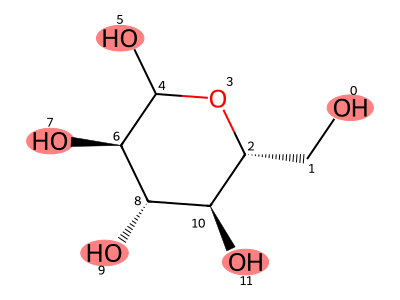

用 `HasSubstructMatch`，電腦能回答「這個分子有沒有 OH」。可是葡萄糖不只一個 OH，答案只有「有」，還是不知道到底幾個。想要電腦幫忙數，就得換一個函式。

## 動手玩

選好分子後，按「下一個」，電腦一次只塗一個 OH，並告訴你這是第幾個、在哪個原子上。結構圖上的小數字是原子編號。按「全部顯示」，就一次塗滿。

```{=html}
<div class="rdkit-play" data-mode="step">
<script type="application/json">
{"query": "[OX2H]", "queryLabel": "OH",
 "molecules": [
  {"name": "葡萄糖", "smiles": "OC[C@H]1OC(O)[C@H](O)[C@@H](O)[C@@H]1O"},
  {"name": "蔗糖（砂糖）", "smiles": "OC[C@H]1O[C@@](CO)(O[C@H]2O[C@H](CO)[C@@H](O)[C@H](O)[C@H]2O)[C@@H](O)[C@@H]1O"},
  {"name": "甘油", "smiles": "OCC(O)CO"},
  {"name": "酒精（乙醇）", "smiles": "CCO"},
  {"name": "咖啡因", "smiles": "CN1C=NC2=C1C(=O)N(C(=O)N2C)C"}
]}
</script>
<figure class="rdkit-play-fallback">

<figcaption>電腦在葡萄糖裡找到 5 個 OH，並全部塗上顏色。</figcaption>
</figure>
</div>
```

## 剛才發生什麼事？

搜尋條件是代表 OH 的 `[OX2H]`，意思是「一個氧，總共接兩樣東西，其中一個是氫」。這次換了函式：`HasSubstructMatch` 找到第一個就停下來，只回答「有」或「沒有」；`GetSubstructMatches` 會把整個分子找完，每找到一個 OH，就記下一組原子編號。

所以有幾組，就有幾個 OH。葡萄糖找到 5 組，原子編號是 0、5、7、9、11：4 個 OH 在六角形的環上，1 個掛在環外的 CH2 上。小框按「下一個」，就是照順序一組一組拿出來塗色。

編號 3 也是氧，卻沒有被算進去。這個氧在環裡，兩邊都接碳，沒有接氫，所以不是 OH。

## 真正的程式

```python
from rdkit import Chem

oh = Chem.MolFromSmarts("[OX2H]")
glucose = Chem.MolFromSmiles("OC[C@H]1OC(O)[C@H](O)[C@@H](O)[C@@H]1O")
matches = glucose.GetSubstructMatches(oh)
print(matches)
print(len(matches))
```

第一行印出 `((0,), (5,), (7,), (9,), (11,))`，每個括號是一組原子編號；第二行印出 `5`。`len` 是 Python 用來數「有幾個」的函式。

[](https://colab.research.google.com/github/517justin/cheminfo-blog/blob/main/posts/2026-11-rdkit-18-getsubstructmatches/ep18.ipynb)
[下載這一集的 notebook](ep18.ipynb)

## 換你試

- 選蔗糖（砂糖），一直按「下一個」，數數看是不是 8 個 OH。
- 選甘油，保養品和肥皂裡常見的甘油有 3 個 OH。

## 延伸閱讀

- 《化學資訊學入門》[子結構搜尋與 SMARTS](https://517justin.github.io/cheminfo-intro/chapters/ch02/02-03-substructure-smarts.html)
- RDKit 官方文件：[Substructure Searching](https://www.rdkit.org/docs/GettingStartedInPython.html#substructure-searching)
