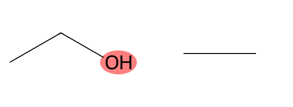

酒精（乙醇）有一個 OH。如果把 OH 拿掉，剩下的兩個碳會變成什麼？在紙上可以直接擦掉，電腦則要先找到那一塊結構，再把它刪掉。

## 動手玩

從選單挑一個分子，或在輸入框改 SMILES。左邊把要刪掉的 OH 塗上顏色，右邊是刪掉之後剩下的分子。

```{=html}
<div class="rdkit-play" data-mode="delete">
<script type="application/json">
{"query": "[OX2H]", "queryLabel": "OH",
 "molecules": [
  {"name": "酒精（乙醇）", "smiles": "CCO"},
  {"name": "甲醇", "smiles": "CO"},
  {"name": "甘油", "smiles": "OCC(O)CO"},
  {"name": "醋酸（乙酸）", "smiles": "CC(=O)O"},
  {"name": "苯酚", "smiles": "Oc1ccccc1"}
]}
</script>
<figure class="rdkit-play-fallback">

<figcaption>酒精（乙醇）拿掉 OH，剩下乙烷。</figcaption>
</figure>
</div>
```

## 剛才發生什麼事？

`DeleteSubstructs` 做兩件事：先在分子裡找出符合條件的地方，再把那些原子整個刪掉。這裡的條件是代表 OH 的 `[OX2H]`。

酒精（乙醇）的 `CCO` 刪掉 OH 之後剩下 `CC`，也就是乙烷。原本接著氧的那個碳，少了一個鄰居，RDKit 會自動幫它補上一個氫，所以剩下的是完整的乙烷，不是缺了一角的碳鏈。

刪除是照規則做的，不管化學上合不合理。醋酸（乙酸）刪掉 OH 會變成乙醛 `CC=O`；甘油的 3 個 OH 全部刪掉，剩下丙烷。這些都不是真正會發生的化學反應，只是電腦照著指令把原子拿掉。實務上常用這個功能清理資料，例如把分子裡不需要的部分去掉。

## 真正的程式

```python
from rdkit import Chem

oh = Chem.MolFromSmarts("[OX2H]")
mol = Chem.DeleteSubstructs(Chem.MolFromSmiles("CCO"), oh)
print(Chem.MolToSmiles(mol))
```

印出 `CC`，也就是乙烷。

[](https://colab.research.google.com/github/517justin/cheminfo-blog/blob/main/posts/2026-11-rdkit-19-deletesubstructs/ep19.ipynb)
[下載這一集的 notebook](ep19.ipynb)

## 換你試

- 選苯酚，刪掉 OH 之後剩下什麼？
- 在輸入框打咖啡因 `CN1C=NC2=C1C(=O)N(C(=O)N2C)C`。咖啡因有兩個氧，為什麼一個都沒被刪掉？

## 延伸閱讀

- 《化學資訊學入門》[子結構搜尋與 SMARTS](https://517justin.github.io/cheminfo-intro/chapters/ch02/02-03-substructure-smarts.html)
- RDKit 官方文件：[Substructure-based transformations](https://www.rdkit.org/docs/GettingStartedInPython.html#substructure-based-transformations)
