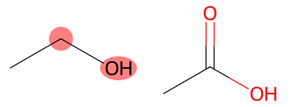

酒放久了打開，有時會聞到一股酸味。原因是空氣裡的醋酸菌跑了進去，把酒精（乙醇）變成醋酸（乙酸）。這是化學課裡「醇變酸」的一個例子：OH 接在碳鏈末端的醇，經過氧化會變成酸。電腦當然不會發酵，但可以照著一條規則，把醇的結構改寫成酸。

## 動手玩

小框裡的電腦只會一條反應規則「醇變酸」：找到接在碳鏈末端的 OH，在那個碳上再加一個用雙鍵相連的氧。酒精（乙醇）會變成醋酸（乙酸），甲醇會變成甲酸（螞蟻身上的酸，又叫蟻酸），丙醇會變成丙酸。OH 不在末端的分子，例如異丙醇，就不符合規則。

從選單挑一個分子，或在輸入框改 SMILES。左邊是反應前的分子，規則比對到的原子會塗上顏色；符合規則的話，右邊會出現反應後的產物，不符合的會顯示沒有反應。

```{=html}
<div class="rdkit-play" data-mode="reaction">
<script type="application/json">
{"rxn": "[CX4;H2,H3:1][OH:2]>>[C:1](=O)[OH:2]", "match": "[CX4;H2,H3][OH]", "ruleLabel": "OH 要接在碳鏈末端", "ruleText": "反應規則：找到接在碳鏈末端的 OH，在那個碳上加一個用雙鍵相連的氧（醇變酸）。",
 "molecules": [
  {"name": "酒精（乙醇）", "smiles": "CCO"},
  {"name": "甲醇", "smiles": "CO"},
  {"name": "丙醇", "smiles": "CCCO"},
  {"name": "異丙醇（OH 不在末端）", "smiles": "CC(C)O"}
]}
</script>
<figure class="rdkit-play-fallback">

<figcaption>照著規則，酒精（乙醇）變成醋酸（乙酸）。</figcaption>
</figure>
</div>
```

## 剛才發生什麼事？

反應規則寫成 `[CX4;H2,H3:1][OH:2]>>[C:1](=O)[OH:2]`，用 `>>` 分成兩半：左邊是「找什麼」，右邊是「改成什麼」。左邊找一個接著 OH 的碳，右邊在這個碳上多接一個用雙鍵相連的氧。`:1`、`:2` 是編號，告訴電腦左右兩邊哪個原子對應哪個原子。

電腦怎麼知道 OH 在不在碳鏈末端？看那個碳身上還有幾個氫。末端的碳至少還有兩個氫，酒精、甲醇、丙醇都是這樣；異丙醇的 OH 接在中間的碳上，那個碳只剩一個氫，所以不符合。規則裡的 `H2,H3` 就是在寫這個條件。

`ReactionFromSmarts` 把這串字讀成反應規則，`RunReactants` 再拿分子去套。電腦只會照規則改寫結構，不管反應在真實世界要怎麼發生。真實世界裡，醇要靠氧化劑或細菌才會變成酸；醋酸菌是分兩步把酒精氧化成醋酸，中間會先變成乙醛。異丙醇在真實世界也能氧化，但會變成丙酮，不會變成酸。

## 真正的程式

```python
from rdkit import Chem
from rdkit.Chem import AllChem

rxn = AllChem.ReactionFromSmarts("[CX4;H2,H3:1][OH:2]>>[C:1](=O)[OH:2]")
products = rxn.RunReactants((Chem.MolFromSmiles("CCO"),))
print(Chem.MolToSmiles(products[0][0]))
```

印出 `CC(=O)O`，也就是醋酸（乙酸）。`products[0][0]` 是第一組結果裡的第一個產物。

[](https://colab.research.google.com/github/517justin/cheminfo-blog/blob/main/posts/2026-11-rdkit-20-reactionfromsmarts/ep20.ipynb)
[下載這一集的 notebook](ep20.ipynb)

## 換你試

- 選甲醇和丙醇，看看各自變成什麼酸。
- 在輸入框打甘油 `OCC(O)CO`。甘油有 3 個 OH，哪幾個符合規則？

## 延伸閱讀

- 《化學資訊學入門》[產生 3D 構形與化學反應](https://517justin.github.io/cheminfo-intro/chapters/ch02/02-05-conformers-and-reactions.html)
- RDKit 官方文件：[Chemical Reactions](https://www.rdkit.org/docs/GettingStartedInPython.html#chemical-reactions)
- 醋酸菌把酒精變成醋酸的過程：Gomes 等人，[Acetic Acid Bacteria in the Food Industry](https://pmc.ncbi.nlm.nih.gov/articles/PMC6117990/)，*Food Technology and Biotechnology*（英文）
