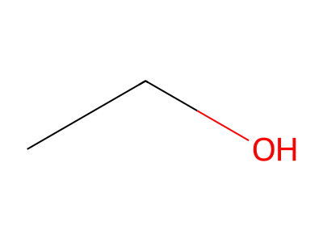

同一個酒精（乙醇），SMILES 可以寫成 `CCO`，也可以寫成 `OCC`。要在資料庫裡查一個分子，寫法不同就可能查不到，很不方便。化學家的解法是：替每個分子發一張固定的身分證。

## 動手玩

從選單挑一個分子，或在輸入框改 SMILES，下方會顯示這個分子的身分證號碼。

```{=html}
<div class="rdkit-play" data-mode="inchikey">
<script type="application/json">
{"molecules": [
  {"name": "酒精（乙醇）：從碳開始寫", "smiles": "CCO"},
  {"name": "酒精（乙醇）：從氧開始寫", "smiles": "OCC"},
  {"name": "二甲醚", "smiles": "COC"},
  {"name": "咖啡因", "smiles": "CN1C=NC2=C1C(=O)N(C(=O)N2C)C"},
  {"name": "葡萄糖", "smiles": "OC[C@H]1OC(O)[C@H](O)[C@@H](O)[C@@H]1O"}
]}
</script>
<figure class="rdkit-play-fallback">

<figcaption>酒精（乙醇）的身分證號碼是 <code>LFQSCWFLJHTTHZ-UHFFFAOYSA-N</code>。</figcaption>
</figure>
</div>
```

## 剛才發生什麼事？

這張身分證叫做 **InChIKey**。它由 InChI 壓縮而來，InChI 是國際純粹與應用化學聯合會（IUPAC）制定的標準寫法。不管 SMILES 怎麼寫，只要是同一個分子，算出來的 InChIKey 就一樣，所以兩種酒精寫法會得到同一組號碼。

InChIKey 固定 27 個字元，用 `-` 分成三段：第一段代表原子怎麼連接，第二段記錄立體結構等細節，最後一個字母和電荷有關。

試試選單裡的二甲醚：它和酒精（乙醇）的分子式都是 C2H6O，但原子連接的方式不同，所以第一段就不一樣。PubChem 這類化學資料庫都能用 InChIKey 查詢。

## 真正的程式

```python
from rdkit import Chem

for smi in ["CCO", "OCC"]:
    print(Chem.MolToInchiKey(Chem.MolFromSmiles(smi)))
```

兩行都印出 `LFQSCWFLJHTTHZ-UHFFFAOYSA-N`。

[](https://colab.research.google.com/github/517justin/cheminfo-blog/blob/main/posts/2026-11-rdkit-21-moltoinchikey/ep21.ipynb)
[下載這一集的 notebook](ep21.ipynb)

## 換你試

- 選咖啡因，把身分證號碼複製下來，貼到 [PubChem](https://pubchem.ncbi.nlm.nih.gov/) 的搜尋框，看看會不會查到咖啡因。
- 比較酒精（乙醇）和二甲醚的號碼，哪一段不一樣？

## 延伸閱讀

- 《化學資訊學入門》[InChI 與 InChIKey](https://517justin.github.io/cheminfo-intro/chapters/ch01/01-03-inchi-and-inchikey.html)
- RDKit 官方文件：[Writing molecules](https://www.rdkit.org/docs/GettingStartedInPython.html#writing-molecules)
