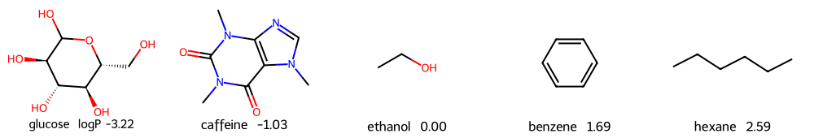

糖丟進水裡一下子就溶了，丟進油裡卻怎麼攪都溶不掉；沙拉油倒進水裡，會浮成一層分不開。有些分子喜歡待在水裡，有些喜歡待在油裡。這個性質影響很大，例如一顆藥吞下去之後，能不能被身體吸收。

## 動手玩

從選單挑一個分子，或在輸入框改 SMILES，下方會算出 logP，並在「喜歡水 ← → 喜歡油」的橫條上標出位置。

```{=html}
<div class="rdkit-play" data-mode="logp">
<script type="application/json">
{"molecules": [
  {"name": "葡萄糖", "smiles": "OC[C@H]1OC(O)[C@H](O)[C@@H](O)[C@@H]1O"},
  {"name": "咖啡因", "smiles": "CN1C=NC2=C1C(=O)N(C(=O)N2C)C"},
  {"name": "酒精（乙醇）", "smiles": "CCO"},
  {"name": "苯", "smiles": "c1ccccc1"},
  {"name": "己烷（汽油的成分之一）", "smiles": "CCCCCC"}
]}
</script>
<figure class="rdkit-play-fallback">

<figcaption>葡萄糖的 logP 是 −3.22，比較喜歡水。</figcaption>
</figure>
</div>
```

## 剛才發生什麼事？

**logP** 是用來表示「喜歡水還是喜歡油」的數字。實驗上的做法是把分子放進一半水、一半油（辛醇）的瓶子裡搖一搖，看它在兩邊各有多少，再取對數。logP 是正的，代表待在油裡的比較多；是負的，代表待在水裡的比較多；接近 0，就是兩邊差不多。

`MolLogP` 不用做實驗。RDKit 看分子裡每個原子是什麼、接了什麼，每一種都有一個事先定好的分數，全部加起來就是估計的 logP。所以它算得很快，但只是估計值，和實驗量到的數字會有落差。

選單裡的分子從上到下，logP 越來越大。葡萄糖有 5 個 OH，OH 和水分子很合得來，所以 logP 是 −3.22；己烷全是碳和氫，logP 是 2.59。酒精（乙醇）算出來是 −0.0014，非常接近 0：它有一個 OH，又有兩個碳，所以和水、和油都能混在一起。

## 真正的程式

```python
from rdkit import Chem
from rdkit.Chem import Descriptors

for smi in ["OC[C@H]1OC(O)[C@H](O)[C@@H](O)[C@@H]1O", "CCO", "CCCCCC"]:
    print(f"{Descriptors.MolLogP(Chem.MolFromSmiles(smi)):.2f}")
```

印出 `-3.22`、`-0.00`、`2.59`，分別是葡萄糖、酒精（乙醇）、己烷。酒精的 `-0.00` 是因為實際值 −0.0014 四捨五入到小數點後兩位。

[](https://colab.research.google.com/github/517justin/cheminfo-blog/blob/main/posts/2026-11-rdkit-22-mollogp/ep22.ipynb)
[下載這一集的 notebook](ep22.ipynb)

## 換你試

- 咖啡因比較喜歡水還是油？看看它在橫條上的位置。
- 在輸入框把己烷的 `CCCCCC` 末端加一個 `O`，變成己醇 `CCCCCCO`。多了一個 OH，logP 會往哪邊移？

## 延伸閱讀

- 《化學資訊學入門》[常用物化描述符（分子量、logP、TPSA）](https://517justin.github.io/cheminfo-intro/chapters/ch04/04-02-physicochemical-descriptors.html)
- RDKit 官方文件：[Descriptor Calculation](https://www.rdkit.org/docs/GettingStartedInPython.html#descriptor-calculation)
