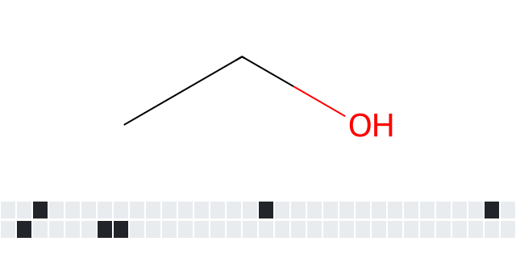

超市的商品都印著條碼，結帳時掃一下，電腦就知道是哪一件。分子也可以做成條碼：把結構轉成一串 0 和 1，電腦比較兩串數字，比比較兩張結構圖快得多。這種條碼叫做 **分子指紋**（molecular fingerprint）。

## 動手玩

從選單挑一個分子，或在輸入框改 SMILES，下方會畫出它的條碼：64 格，深色是 1，淺色是 0。再換一個分子，上一個分子的條碼會留在下面，方便對照哪幾格不一樣。

```{=html}
<div class="rdkit-play" data-mode="fingerprint">
<script type="application/json">
{"molecules": [
  {"name": "酒精（乙醇）", "smiles": "CCO"},
  {"name": "甲醇", "smiles": "CO"},
  {"name": "丙醇", "smiles": "CCCO"},
  {"name": "苯", "smiles": "c1ccccc1"},
  {"name": "咖啡因", "smiles": "CN1C=NC2=C1C(=O)N(C(=O)N2C)C"}
]}
</script>
<figure class="rdkit-play-fallback">

<figcaption>酒精（乙醇）的條碼：64 格裡有 6 格是 1。</figcaption>
</figure>
</div>
```

## 剛才發生什麼事？

這裡用的是 **Morgan 指紋**（Morgan fingerprint）。RDKit 從每個原子出發，看它自己、它的鄰居、鄰居的鄰居長什麼樣子。每一種「附近的樣子」都會被換算成一個號碼，條碼上對應號碼的那一格就設成 1。

所以兩個分子如果有相同的局部結構，條碼上就會有相同的格子亮起來。酒精（乙醇）和丙醇都有 CH2 接 OH 這一段，對照兩條條碼，會有幾格一起亮。苯和酒精沒有共同的局部結構，亮的格子完全不重疊。

小框只用 64 格，是為了讓條碼放得進畫面。格子太少，不同的局部結構有時會擠到同一格。實際使用時常用 2048 格，擠在一起的機會就小很多。

## 真正的程式

```python
from rdkit import Chem
from rdkit.Chem import rdFingerprintGenerator

gen = rdFingerprintGenerator.GetMorganGenerator(radius=2, fpSize=64)
fp = gen.GetFingerprint(Chem.MolFromSmiles("CCO"))
print(fp.ToBitString())
```

印出 64 個 0 和 1：`0010000000000000100000000000001001000011000000000000000000000000`，其中有 6 個 1。`radius=2` 是往外看兩層鄰居，`fpSize=64` 是條碼有 64 格。

[](https://colab.research.google.com/github/517justin/cheminfo-blog/blob/main/posts/2026-11-rdkit-23-morganfingerprint/ep23.ipynb)
[下載這一集的 notebook](ep23.ipynb)

## 換你試

- 先選酒精（乙醇），再選甲醇，對照兩條條碼，哪幾格不一樣？
- 選咖啡因，數數看有幾格是 1。分子越大，亮的格子會越多嗎？

## 延伸閱讀

- 《化學資訊學入門》[什麼是分子指紋](https://517justin.github.io/cheminfo-intro/chapters/ch06/06-01-molecular-fingerprints.html)、[Morgan 指紋](https://517justin.github.io/cheminfo-intro/chapters/ch06/06-02-morgan-fingerprints.html)
- RDKit 官方文件：[Morgan Fingerprints (Circular Fingerprints)](https://www.rdkit.org/docs/GettingStartedInPython.html#morgan-fingerprints-circular-fingerprints)
