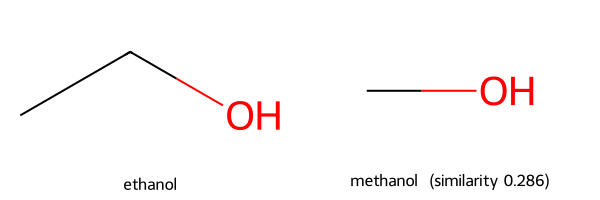

咖啡因和巧克力裡的可可鹼，看結構圖就覺得很像；酒精（乙醇）和苯，看起來一點都不像。可是「很像」到底是多像？要讓電腦從幾萬個分子裡找出和某個藥最像的，就得把「像」變成一個數字。

## 動手玩

從選單挑一組分子，或直接改左右兩個輸入框。下方會算出相似度，並把算式寫出來：0 是完全不像，1 是一模一樣。

```{=html}
<div class="rdkit-play" data-mode="similarity">
<script type="application/json">
{"pairs": [
  {"name": "酒精（乙醇）和甲醇", "a": "CCO", "b": "CO"},
  {"name": "酒精（乙醇）和丙醇", "a": "CCO", "b": "CCCO"},
  {"name": "咖啡因和可可鹼（巧克力裡）", "a": "CN1C=NC2=C1C(=O)N(C(=O)N2C)C", "b": "Cn1cnc2c1c(=O)[nH]c(=O)n2C"},
  {"name": "酒精（乙醇）和苯", "a": "CCO", "b": "c1ccccc1"}
]}
</script>
<figure class="rdkit-play-fallback">

<figcaption>酒精（乙醇）和甲醇的相似度是 0.286。</figcaption>
</figure>
</div>
```

## 剛才發生什麼事？

電腦先把兩個分子都做成條碼，也就是 Morgan 指紋，這裡用 2048 格。接著數兩種格子：

- 兩邊都是 1 的格子：代表兩個分子共有的局部結構。
- 至少一邊是 1 的格子：代表兩個分子加起來所有的局部結構。

前者除以後者，就是 **Tanimoto 相似度**（Tanimoto similarity）。兩個分子一模一樣，兩個數字相等，相似度是 1；完全沒有共同的局部結構，相似度是 0。

酒精（乙醇）和甲醇都很小，加起來只有 7 格亮，其中 2 格共有，所以是 2 ÷ 7 ≈ 0.286。咖啡因和可可鹼只差一個甲基，34 格裡共有 18 格，相似度 0.529。酒精和苯沒有任何一格重疊，相似度是 0。

相似度只是比較條碼，不代表兩個分子的性質一定接近，但它算得非常快，很適合先從大量分子裡挑出可能有關的候選。

## 真正的程式

```python
from rdkit import Chem, DataStructs
from rdkit.Chem import rdFingerprintGenerator

gen = rdFingerprintGenerator.GetMorganGenerator(radius=2, fpSize=2048)
fp = lambda s: gen.GetFingerprint(Chem.MolFromSmiles(s))
print(round(DataStructs.TanimotoSimilarity(fp("CCO"), fp("CO")), 3))
```

印出 `0.286`。`lambda` 是一種很短的函式寫法，這裡用來把「SMILES 轉成指紋」包成一個步驟。

[](https://colab.research.google.com/github/517justin/cheminfo-blog/blob/main/posts/2026-11-rdkit-24-tanimotosimilarity/ep24.ipynb)
[下載這一集的 notebook](ep24.ipynb)

## 換你試

- 選「咖啡因和可可鹼」，相似度是多少？再把右邊改成茶鹼 `Cn1c(=O)c2[nH]cnc2n(C)c1=O`，哪一個和咖啡因比較像？
- 把右邊改成和左邊一樣的 SMILES，相似度會是多少？

## 延伸閱讀

- 《化學資訊學入門》[Tanimoto 相似度](https://517justin.github.io/cheminfo-intro/chapters/ch06/06-04-tanimoto-similarity.html)
- RDKit 官方文件：[Fingerprinting and Molecular Similarity](https://www.rdkit.org/docs/GettingStartedInPython.html#fingerprinting-and-molecular-similarity)
