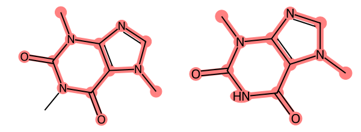

咖啡因在咖啡和茶裡，可可鹼在巧克力裡，兩個的結構幾乎一樣。比相似度可以得到一個數字，但看不出「哪裡一樣、哪裡不一樣」。想知道兩個分子共有的是哪一塊，要換一種方法。

## 動手玩

從選單挑一組分子，或直接改左右兩個輸入框。電腦會找出兩邊共有的最大一塊結構，在兩邊都塗上顏色；沒塗到的地方，就是兩個分子不一樣的地方。

```{=html}
<div class="rdkit-play" data-mode="mcs">
<script type="application/json">
{"pairs": [
  {"name": "咖啡因和可可鹼（巧克力裡）", "a": "CN1C=NC2=C1C(=O)N(C(=O)N2C)C", "b": "Cn1cnc2c1c(=O)[nH]c(=O)n2C"},
  {"name": "咖啡因和茶鹼（茶裡）", "a": "CN1C=NC2=C1C(=O)N(C(=O)N2C)C", "b": "Cn1c(=O)c2[nH]cnc2n(C)c1=O"},
  {"name": "酒精（乙醇）和醋酸（乙酸）", "a": "CCO", "b": "CC(=O)O"}
]}
</script>
<figure class="rdkit-play-fallback">

<figcaption>咖啡因和可可鹼共有 13 個原子，咖啡因只多了一個甲基。</figcaption>
</figure>
</div>
```

## 剛才發生什麼事？

`FindMCS` 找的是 **最大共同子結構**（maximum common substructure），也就是兩個分子都有、而且越大越好的那一塊。結果裡的 `numAtoms` 是這一塊有幾個原子。

咖啡因有 14 個原子（不算氫），可可鹼有 13 個，最大共同子結構剛好是 13 個。換句話說，可可鹼整個都包含在咖啡因裡面，咖啡因只是多了一個甲基（CH3）。換成茶鹼，共同部分一樣是 13 個原子，但沒塗到的甲基換了一個位置：可可鹼和茶鹼都比咖啡因少一個甲基，只是少在不同的地方。

找最大共同子結構要一個一個試各種可能的組合，分子一大就會算很久，所以實務上常會設定時間上限。

## 真正的程式

```python
from rdkit import Chem
from rdkit.Chem import rdFMCS

caffeine = Chem.MolFromSmiles("CN1C=NC2=C1C(=O)N(C(=O)N2C)C")
theobromine = Chem.MolFromSmiles("Cn1cnc2c1c(=O)[nH]c(=O)n2C")
print(rdFMCS.FindMCS([caffeine, theobromine]).numAtoms)
```

印出 `13`。

[](https://colab.research.google.com/github/517justin/cheminfo-blog/blob/main/posts/2026-11-rdkit-25-findmcs/ep25.ipynb)
[下載這一集的 notebook](ep25.ipynb)

## 換你試

- 選「咖啡因和茶鹼」，和可可鹼那一組比，沒塗到的甲基在哪裡？
- 選「酒精（乙醇）和醋酸（乙酸）」，共同部分有幾個原子？醋酸多出來的是什麼？

## 延伸閱讀

- RDKit 官方文件：[Maximum Common Substructure](https://www.rdkit.org/docs/GettingStartedInPython.html#maximum-common-substructure)
