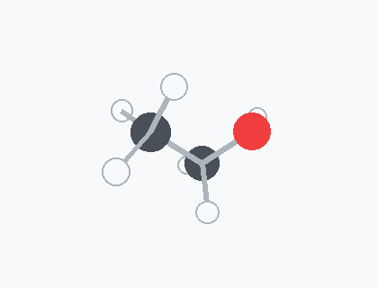

課本和這個系列畫的結構圖，都是平平的畫在紙上。真正的分子是立體的：甲烷的 4 個氫分散在碳的四周，水分子彎成一個角度，二氧化碳卻是一直線。電腦要怎麼知道每個原子在空間裡的位置？

## 動手玩

從選單挑一個分子，下方是它的 3D 球棒模型，會自己慢慢轉；按住拖曳，可以自己轉到想看的角度。灰色是碳、紅色是氧、藍色是氮、白色是氫。

```{=html}
<div class="rdkit-play" data-mode="spin">
<script type="application/json">
{"molecules":[{"name":"酒精（乙醇）","atoms":[["C",-0.964,0.015,0.041],["C",0.504,-0.308,-0.204],["O",1.224,0.342,0.779],["H",-1.356,0.741,-0.704],["H",-1.583,-0.914,-0.003],["H",-1.029,0.517,1.03],["H",0.772,-0.006,-1.23],["H",0.598,-1.418,-0.169],["H",1.834,1.032,0.46]],"bonds":[[0,1,1],[1,2,1],[0,3,1],[0,4,1],[0,5,1],[1,6,1],[1,7,1],[2,8,1]]},{"name":"甲烷（天然氣的主要成分）","atoms":[["C",-0.021,0.003,0.016],["H",-0.665,0.888,-0.108],["H",-0.38,-0.861,-0.582],["H",0.095,-0.307,1.066],["H",0.972,0.277,-0.392]],"bonds":[[0,1,1],[0,2,1],[0,3,1],[0,4,1]]},{"name":"水","atoms":[["O",-0.006,0.384,-0.0],["H",-0.797,-0.194,-0.0],["H",0.803,-0.19,0.0]],"bonds":[[0,1,1],[0,2,1]]},{"name":"二氧化碳","atoms":[["O",-1.138,0.1,0.0],["C",-0.001,-0.386,0.0],["O",1.139,-0.852,0.0]],"bonds":[[0,1,2],[1,2,2]]},{"name":"咖啡因","atoms":[["C",3.202,0.692,-0.276],["N",2.127,-0.274,-0.29],["C",2.233,-1.597,-0.491],["N",0.981,-2.121,-0.421],["C",0.107,-1.14,-0.181],["C",0.817,0.037,-0.095],["C",0.167,1.232,0.15],["O",0.766,2.314,0.235],["N",-1.177,1.168,0.296],["C",-1.866,0.014,0.211],["O",-3.13,0.055,0.362],["N",-1.229,-1.133,-0.026],["C",-1.943,-2.397,-0.124],["C",-1.922,2.398,0.557],["H",4.196,0.216,-0.057],["H",3.297,1.274,-1.221],["H",3.022,1.474,0.516],["H",3.154,-2.132,-0.673],["H",-1.282,-3.227,-0.465],["H",-2.223,-2.665,0.936],["H",-2.821,-2.34,-0.771],["H",-2.771,2.168,1.265],["H",-2.419,2.772,-0.372],["H",-1.286,3.211,0.934]],"bonds":[[0,1,1],[1,2,1],[2,3,2],[3,4,1],[4,5,2],[5,6,1],[6,7,2],[6,8,1],[8,9,1],[9,10,2],[9,11,1],[11,12,1],[8,13,1],[5,1,1],[11,4,1],[0,14,1],[0,15,1],[0,16,1],[2,17,1],[12,18,1],[12,19,1],[12,20,1],[13,21,1],[13,22,1],[13,23,1]]},{"name":"葡萄糖","atoms":[["O",2.916,0.435,-0.956],["C",2.34,-0.4,0.007],["C",0.854,-0.285,0.11],["O",0.264,-1.112,1.066],["C",-0.969,-1.447,0.537],["O",-0.714,-2.318,-0.523],["C",-1.772,-0.307,0.009],["O",-2.21,-0.684,-1.263],["C",-1.138,1.017,-0.076],["O",-1.899,2.025,0.519],["C",0.317,1.079,0.366],["O",0.995,2.041,-0.381],["H",3.75,0.014,-1.279],["H",2.881,-0.381,0.975],["H",2.523,-1.44,-0.397],["H",0.441,-0.593,-0.894],["H",-1.527,-2.014,1.314],["H",0.1,-2.837,-0.301],["H",-2.712,-0.242,0.63],["H",-2.977,-0.167,-1.57],["H",-1.085,1.3,-1.168],["H",-2.447,2.476,-0.179],["H",0.356,1.398,1.41],["H",1.71,2.443,0.17]],"bonds":[[0,1,1],[1,2,1],[2,3,1],[3,4,1],[4,5,1],[4,6,1],[6,7,1],[6,8,1],[8,9,1],[8,10,1],[10,11,1],[10,2,1],[0,12,1],[1,13,1],[1,14,1],[2,15,1],[4,16,1],[5,17,1],[6,18,1],[7,19,1],[8,20,1],[9,21,1],[10,22,1],[11,23,1]]}]}
</script>
<figure class="rdkit-play-fallback">

<figcaption>酒精（乙醇）的 3D 球棒模型，氫也畫出來了。</figcaption>
</figure>
</div>
```

## 剛才發生什麼事？

SMILES 只記錄原子怎麼接，沒有記錄位置。`EmbedMolecule` 依照化學規則，例如鍵大概多長、鍵和鍵之間大概張開幾度，替每個原子算出一組 3D 座標，這組座標叫做 **構形**（conformer）。

算之前要先用 `AddHs` 把氫加上去。氫雖然小，卻會佔位置，少了氫，算出來的形狀就不對。所以小框裡的模型都有畫出氫。

算座標的過程有用到隨機數，每次算的結果會有一點點不同，`randomSeed` 是固定隨機數的起點，讓每次算出來都一樣。這個小框的座標就是先用 Python 這樣算好，再放進網頁裡；網頁版的 RDKit 不能算 3D 座標，所以這個小框不能自己輸入 SMILES。

轉轉看選單裡的分子：甲烷的 4 個氫像一個三角錐的四個角，水是彎的，二氧化碳是直的，咖啡因的兩個環幾乎平躺在同一個平面上。

## 真正的程式

```python
from rdkit import Chem
from rdkit.Chem import AllChem

mol = Chem.AddHs(Chem.MolFromSmiles("CCO"))
print(AllChem.EmbedMolecule(mol, randomSeed=42))
print(mol.GetConformer().Is3D())
```

印出 `0` 和 `True`。`0` 代表座標算成功了，`True` 代表算出來的是 3D 座標。

[](https://colab.research.google.com/github/517justin/cheminfo-blog/blob/main/posts/2026-11-rdkit-26-embedmolecule/ep26.ipynb)
[下載這一集的 notebook](ep26.ipynb)

## 換你試

- 選甲烷，轉到從正上方往下看，再轉到側面看，4 個氫的排法有什麼不同？
- 把程式裡的 `randomSeed=42` 改成別的數字，算出來的座標會變，但分子的形狀差不多。

## 延伸閱讀

- 《化學資訊學入門》[產生 3D 構形與化學反應](https://517justin.github.io/cheminfo-intro/chapters/ch02/02-05-conformers-and-reactions.html)
- RDKit 官方文件：[Working with 3D Molecules](https://www.rdkit.org/docs/GettingStartedInPython.html#working-with-3d-molecules)
